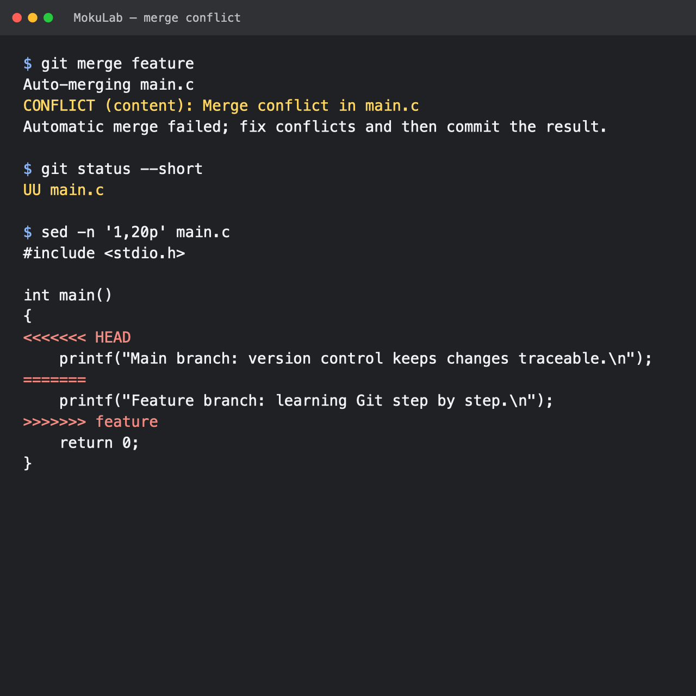
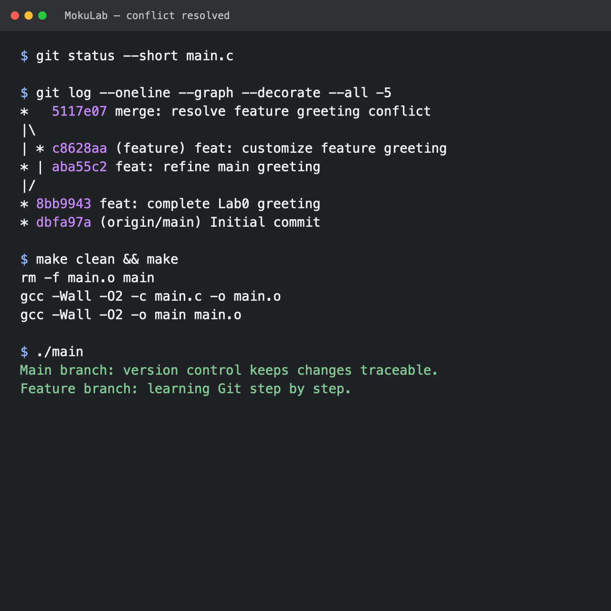

# Lab0 实验报告

## 一、问题回答

### 1. 多人协同开发经历

我以前没有参加过较正式的软件多人协同开发。小组作业一般通过聊天软件分工，再用网盘或群文件交换文件。这种方式在文件较多时容易出现版本混乱，也不容易确认每个人具体修改了什么。通过本次实验，我了解了使用分支、提交和合并进行协作的基本流程。

### 2. Git 为什么设计“暂存—提交”两个步骤

工作区中的修改不一定都属于同一个任务。暂存区可以让我先挑选本次真正要提交的内容，检查无误后再形成一次提交。例如同时修改了程序和实验笔记时，可以只暂存程序，先生成一条内容单一、含义明确的提交记录。这样也能避免把临时文件或未完成的修改误提交进仓库。

### 3. `git branch` 和 `git branch -a` 的区别

`git branch` 默认只列出本地分支，当前分支前会显示 `*`。`git branch -a` 会列出所有分支，除了本地分支，还包括 `remotes/` 开头的远程跟踪分支。因此需要查看远程仓库中已有的分支时，应使用 `git branch -a`。

## 二、阅读材料

### 1. Commit Message 规范

[《Commit message 和 Change log 编写指南》]介绍了规范提交信息的作用和常见格式。清楚的提交信息便于浏览历史、查找某类修改，并可用于自动生成 Change Log。文中介绍的格式由 Header、Body 和 Footer 组成，其中 Header 包括 `type`、可选的 `scope` 和简短的 `subject`。本次实验的提交信息使用了 `feat`、`chore` 和 `merge` 等前缀，使每次修改的目的更容易辨认。

### 2. 为什么要学习 Git

Git 可以保存项目的修改历史，在程序出现问题时帮助定位和恢复旧版本。分支让不同功能可以并行开发，合并机制则帮助整理不同分支上的成果。规范的提交记录和版本号还能让协作者了解修改原因及软件发布情况。即使是个人项目，Git 也比反复复制文件更清楚、更可靠。

## 三、实验步骤

1. 获取模板仓库文件，在本地建立仓库并确认当前分支为 `main`。
2. 修改 `main.c` 中的 TODO，使用 `make` 编译并运行程序。
3. 暂存 `main.c`，提交为 `feat: complete Lab0 greeting`。
4. 新建 `feature` 分支，修改输出语句并提交。
5. 回到 `main` 分支，修改同一行输出语句并提交。
6. 在 `main` 上执行 `git merge feature`。两个分支修改了同一位置，Git 无法自动判断保留哪一项，因此产生内容冲突。
7. 编辑 `main.c`，删除冲突标记并保留两个分支的输出语句，然后暂存文件并完成合并提交。
8. 再次执行 `make clean`、`make` 和 `./main`，程序编译、运行正常。

## 四、合并冲突记录

执行合并后，Git 报告 `main.c` 同时被两个分支修改，文件中出现 `<<<<<<<`、`=======` 和 `>>>>>>>` 冲突标记。

解决冲突后，`main` 分支生成了包含两个父提交的合并提交。程序随后通过编译并输出两个分支中保留的内容。

## 五、实验总结

本次实验完成了 Git 的初始化、暂存、提交、分支切换、冲突处理和分支合并。我对工作区、暂存区和提交历史之间的关系有了更直接的认识，也理解了冲突并不是程序错误，而是 Git 需要开发者明确决定最终内容的提示。
