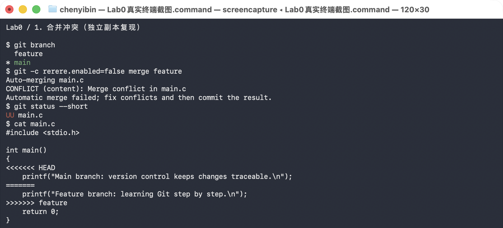
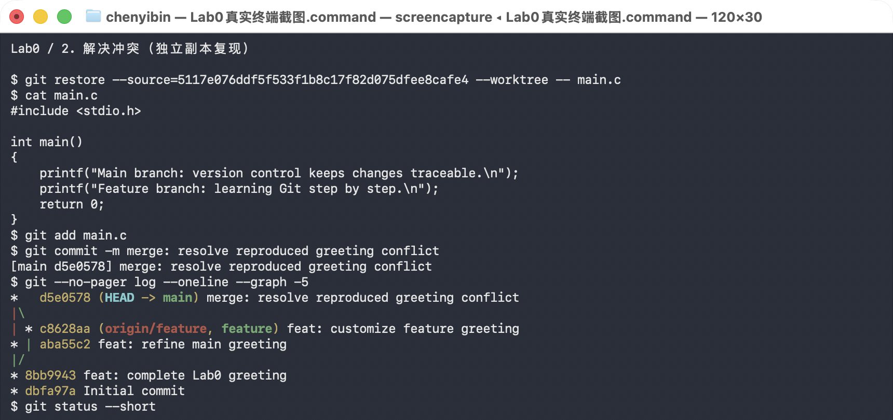
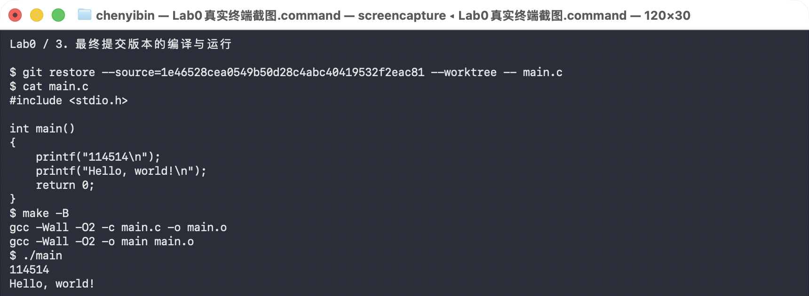

# Lab0 实验报告

## 一、问题回答

### 1. 多人协同开发经历

我以前没有参加过较正式的软件多人协同开发。小组作业一般通过聊天软件分工，再用网盘或群文件交换文件。这种方式在文件较多时容易出现版本混乱，也不容易确认每个人具体修改了什么。通过本次实验，我了解了使用分支、提交和合并进行协作的基本流程。

### 2. Git 为什么设计“暂存—提交”两个步骤

工作区中的修改不一定都属于同一个任务。暂存区可以让我先挑选本次真正要提交的内容，检查无误后再形成一次提交。例如同时修改了程序和实验笔记时，可以只暂存程序，先生成一条内容单一、含义明确的提交记录。这样也能避免把临时文件或未完成的修改误提交进仓库。

### 3. `git branch` 和 `git branch -a` 的区别

`git branch` 默认只列出本地分支，当前分支前会显示 `*`。`git branch -a` 同时列出本地分支和本地记录的远程跟踪分支，例如 `remotes/origin/main`。它不会主动联网更新远程信息；如果需要查看远程最新的分支情况，应先执行 `git fetch origin`，再执行 `git branch -a`。参考：[Git 官方文档](https://git-scm.com/docs/git-branch)。

## 二、阅读材料

### 1. Commit Message 规范

[《Commit message 和 Change log 编写指南》](https://www.ruanyifeng.com/blog/2016/01/commit_message_change_log.html)介绍了规范提交信息的作用和常见格式。清楚的提交信息便于浏览历史、查找某类修改，并可用于自动生成 Change Log。文中介绍的格式由必需的 Header 和可选的 Body、Footer 组成，其中 Header 包括 `type`、可选的 `scope` 和简短的 `subject`。本次实验采用了文中介绍的 `feat`、`chore` 和 `docs` 等前缀。合并提交中的 `merge` 是本次自行使用的说明前缀，不属于文章列出的七种类型；Git 本身不强制采用这套格式。

### 2. 语义化版本

[《语义化版本 2.0.0》](https://semver.org/lang/zh-CN/)以明确的公共 API 为基础，用“主版本号.次版本号.修订号”说明版本变化的性质。对于已经发布稳定 API 的软件，不兼容的 API 修改需要增加主版本号，向下兼容的功能新增需要增加次版本号，向下兼容的问题修复需要增加修订号。例如，`1.2.3` 修复问题后可以发布为 `1.2.4`，增加兼容功能后可以发布为 `1.3.0`。已经发布的版本不能直接修改内容，应发布新版本。语义化版本便于判断更新对使用者的影响，而 Git 记录具体修改历史，两者可以配合使用，但并非每次 Git 提交都需要发布一个新版本。

### 3. 为什么要学习 Git

Git 可以保存项目的修改历史，在程序出现问题时帮助定位和恢复旧版本。分支让不同功能可以并行开发，合并机制则帮助整理不同分支上的成果。规范的提交记录和版本号还能让协作者了解修改原因及软件发布情况。即使是个人项目，Git 也比反复复制文件更清楚、更可靠。

## 三、实验步骤

1. 获取模板仓库文件，在本地建立仓库并确认当前分支为 `main`。
2. 修改 `main.c` 中的 TODO，使用 `make` 编译并运行程序。
3. 暂存 `main.c`，提交为 `feat: complete Lab0 greeting`。
4. 新建 `feature` 分支，修改输出语句并提交。
5. 回到 `main` 分支，修改同一行输出语句并提交。
6. 在 `main` 上执行 `git merge feature`。两个分支修改了同一位置，Git 无法自动判断保留哪一项，因此产生内容冲突。
7. 编辑 `main.c`，删除冲突标记并保留两个分支的输出语句，然后暂存文件并完成合并提交。
8. 再次执行 `make clean`、`make` 和 `./main`，程序编译、运行正常。
9. 合并完成后，再将两行输出分别修改为 `114514` 和 `Hello, world!`，并在提交 `1e46528` 中保存。这是最终提交的 `main.c` 版本；第 7 步保留的两句英文属于之前的合并阶段。

## 四、合并冲突记录

两个分支相对于共同祖先修改了同一行，且内容不同，执行合并后产生了内容冲突。文件中出现 `<<<<<<<`、`=======` 和 `>>>>>>>` 冲突标记。仅仅修改同一个文件不一定产生冲突，本次冲突的原因是修改位置重叠。

以下截图于 2026 年 9 月 29 日在独立的本地仓库副本中复现实验时取得，使用原实验的两个分支提交重新触发并解决冲突。图片仅裁去底部截图操作提示及其下方空白，保留的终端画面未作修改。



原实验的合并提交为 `5117e07`，其两个父提交分别为 `aba55c2`（主分支修改）和 `c8628aa`（功能分支修改），解决方案保留了两句英文输出。截图复现时，用 `git restore --source=5117e07 --worktree -- main.c` 取回已经解决冲突的文件，再执行 `git add` 和 `git commit`，在副本中生成新的合并提交 `d5e0578`。因此截图中的合并提交哈希与原实验不同，但两者使用相同的父提交和解决方案。最后的 `git status --short` 没有输出，表明副本中的冲突已经解决且修改已提交。此时的英文输出属于合并阶段，最终程序见下一节。



## 五、最终程序与运行结果

最终版本以提交 `1e46528` 中的 `main.c` 为准，程序为：

```c
#include <stdio.h>

int main()
{
    printf("114514\n");
    printf("Hello, world!\n");
    return 0;
}
```

编译运行后的输出为：

```text
114514
Hello, world!
```

以下截图记录了在副本中取回最终版本 `main.c` 后，执行 `make -B` 重新编译并运行的结果。



最终输出虽然仍包含 `Hello, world!`，但增加了一行 `114514`，与模板程序的完整输出不同。合并练习的提交历史得到保留，后续修改输出内容没有撤销之前的分支合并。

## 六、实验总结

本次实验完成了 Git 的初始化、暂存、提交、分支切换、冲突处理和分支合并。我对工作区、暂存区和提交历史之间的关系有了更直接的认识，也理解了冲突并不是程序错误，而是 Git 需要开发者明确决定最终内容的提示。
